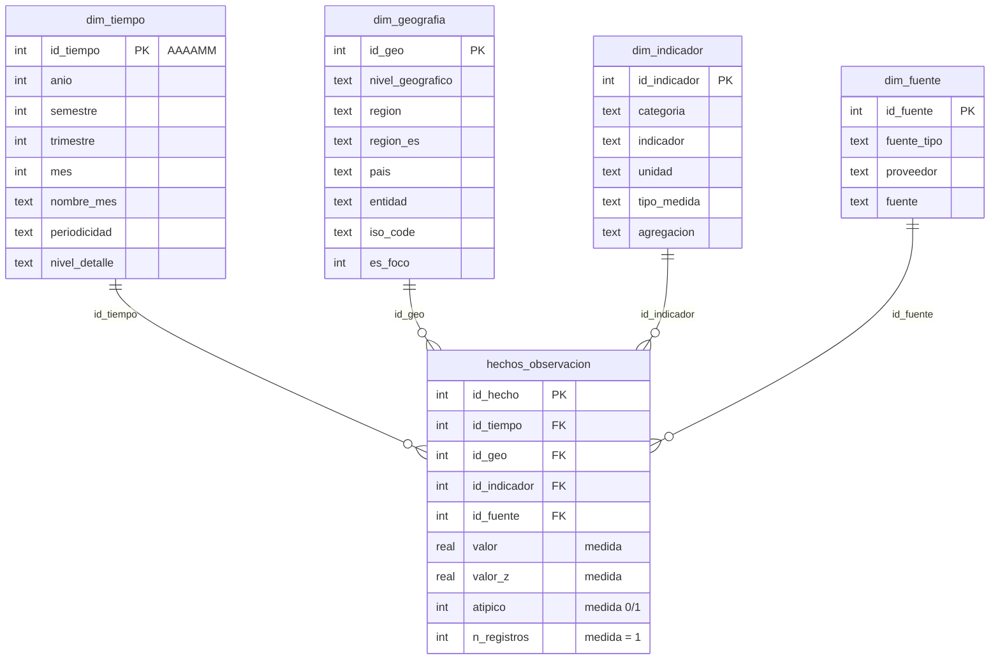

# Modelo multidimensional de ClimaTec (Etapa 5)

Documento generado por `climate-mining-app/scripts/exportar_documentacion.py` a partir del almacen `data/dw/climatec_dw.sqlite`.

## Diagrama del modelo estrella

- **Tabla de hechos:** `hechos_observacion`.
- **Granularidad:** un indicador, para un territorio, en un periodo (anio o mes), segun una fuente. Restriccion `UNIQUE (id_tiempo, id_geo, id_indicador, id_fuente)`.
- **Relaciones:** 1:N desde cada dimension (FOREIGN KEY). Las dimensiones no se relacionan entre si.
- **Miembro desconocido:** clave `-1` en cada dimension.

## Filas por tabla

| Tabla | Filas |
|---|---|
| `hechos_observacion` | 21369 |
| `dim_tiempo` | 86 |
| `dim_geografia` | 241 |
| `dim_indicador` | 25 |
| `dim_fuente` | 6 |

## Diccionario de datos

### `hechos_observacion`

Tabla de hechos. Un registro = un indicador, para un territorio, en un periodo (anio o mes), segun una fuente.

| Campo | Tipo | Clave | Nulo | Descripcion |
|---|---|---|---|---|
| `id_hecho` | INTEGER | PK | No | Clave primaria sustituta (consecutivo). |
| `id_tiempo` | INTEGER | FK → dim_tiempo | No | FK a dim_tiempo. |
| `id_geo` | INTEGER | FK → dim_geografia | No | FK a dim_geografia. |
| `id_indicador` | INTEGER | FK → dim_indicador | No | FK a dim_indicador. |
| `id_fuente` | INTEGER | FK → dim_fuente | No | FK a dim_fuente. |
| `valor` | REAL |  | No | Medida principal: valor observado del indicador (unidad en dim_indicador.unidad). Semiaditiva. |
| `valor_z` | REAL |  | Si | Valor normalizado por indicador (Etapa 2). NULL si no se pudo calcular. Se promedia. |
| `atipico` | INTEGER |  | No | 1 si la limpieza marco el registro como atipico (1,5 × IQR), 0 si no. Se suma. |
| `n_registros` | INTEGER |  | No | Siempre 1. SUM(n_registros) cuenta hechos. |

### `dim_tiempo`

Dimension Tiempo. Jerarquia Anio → Semestre → Trimestre → Mes (solo series mensuales).

| Campo | Tipo | Clave | Nulo | Descripcion |
|---|---|---|---|---|
| `id_tiempo` | INTEGER | PK | No | Clave primaria AAAAMM; MM = 00 en series anuales; -1 = desconocido. |
| `anio` | INTEGER |  | No | Anio de la observacion. |
| `semestre` | INTEGER |  | No | 1 o 2; 0 = no aplica (serie anual). |
| `trimestre` | INTEGER |  | No | 1 a 4; 0 = no aplica. |
| `mes` | INTEGER |  | No | 1 a 12; 0 = no aplica. |
| `nombre_mes` | TEXT |  | No | Abreviatura del mes (Ene…Dic); vacio en series anuales. |
| `periodicidad` | TEXT |  | No | Anual o Mensual. |
| `nivel_detalle` | TEXT |  | No | Anio o Mes: nivel mas fino disponible para el periodo. |

### `dim_geografia`

Dimension Geografia. Jerarquia Mundo → Region → Pais.

| Campo | Tipo | Clave | Nulo | Descripcion |
|---|---|---|---|---|
| `id_geo` | INTEGER | PK | No | Clave primaria sustituta; -1 = desconocido. |
| `nivel_geografico` | TEXT |  | No | Global, Regional o Nacional. |
| `region` | TEXT |  | No | Continente (nombre de la fuente). Para paises se obtiene del ISO3 con data/raw/dim_pais_region.csv. |
| `region_es` | TEXT |  | No | Nombre del continente en espanol. |
| `pais` | TEXT |  | No | Nombre del pais; «No aplica» en agregados. |
| `entidad` | TEXT |  | No | Entidad tal como viene de la fuente (pais, continente o mundo). |
| `iso_code` | TEXT |  | No | Codigo ISO3; «No aplica» en agregados. |
| `es_foco` | INTEGER |  | No | 1 para Colombia, pais foco del proyecto. |

### `dim_indicador`

Dimension Indicador. Jerarquia Categoria → Indicador.

| Campo | Tipo | Clave | Nulo | Descripcion |
|---|---|---|---|---|
| `id_indicador` | INTEGER | PK | No | Clave primaria sustituta; -1 = desconocido. |
| `categoria` | TEXT |  | No | Tema: Emisiones de CO2, Otros gases, Energia, Clima y atmosfera, Demografia. |
| `indicador` | TEXT |  | No | Nombre homologado en la Etapa 3. |
| `unidad` | TEXT |  | No | Unidad de medida del indicador. |
| `tipo_medida` | TEXT |  | No | Absoluto, Per capita, Porcentaje, Anomalia o Concentracion. |
| `agregacion` | TEXT |  | No | Regla al subir de nivel: suma (aditivo entre territorios) o promedio. |

### `dim_fuente`

Dimension Fuente. Jerarquia Tipo de fuente → Proveedor → Fuente.

| Campo | Tipo | Clave | Nulo | Descripcion |
|---|---|---|---|---|
| `id_fuente` | INTEGER | PK | No | Clave primaria sustituta; -1 = desconocido. |
| `fuente_tipo` | TEXT |  | No | Primaria o Terciaria. |
| `proveedor` | TEXT |  | No | Institucion que publica (Our World in Data, NASA, NOAA). |
| `fuente` | TEXT |  | No | Producto de datos concreto. |

## Medidas

| Medida | Unidad | Formula | Agregacion | Tipo | Cuando se suma |
|---|---|---|---|---|---|
| Valor del indicador | La del indicador (Mt CO2, TWh, %, °C, ppm…) | `valor` | SUM si agregacion = suma; AVG si agregacion = promedio | Semiaditiva | Se suma entre paises de una region solo en indicadores absolutos y dentro de un mismo nivel geografico. Per capita, porcentajes, anomalias y concentraciones se promedian (o se toma el agregado oficial). Nunca se suman indicadores distintos ni niveles geograficos distintos. |
| Numero de registros | hechos | `SUM(n_registros) = COUNT(*)` | SUM | Aditiva | Se puede sumar en cualquier dimension y nivel. |
| Registros atipicos | hechos | `SUM(atipico)` | SUM | Aditiva | Se puede sumar en cualquier dimension y nivel. |
| % de atipicos | % | `SUM(atipico) / SUM(n_registros) × 100` | Proporcion (se recalcula) | No aditiva | No se suman ni promedian porcentajes: en cada nivel se recalcula con el numerador y el denominador. |
| Valor z promedio | desviaciones estandar (adimensional) | `SUM(valor_z) / COUNT(valor_z)` | AVG ponderado por conteo | No aditiva | Se promedia; al subir de nivel se usa la suma de z y el conteo de z, no el promedio de promedios. |
| Participacion % | % | `SUM(valor) del miembro / SUM(valor) del padre × 100` | Proporcion (se recalcula) | No aditiva | Solo para indicadores sumables; suma 100% dentro de un mismo padre, pero no entre padres distintos. |
| Paises con dato | paises | `COUNT(DISTINCT id_geo) con nivel Nacional` | Conteo distinto | No aditiva | Se puede sumar entre regiones de un mismo anio (un pais esta en una sola region), pero no entre anios ni entre indicadores: el mismo pais se contaria varias veces. |

## Jerarquias

| Dimension | Niveles | Validez |
|---|---|---|
| Tiempo | Anio → Semestre → Trimestre → Mes | Cada mes pertenece a un solo trimestre, cada trimestre a un solo semestre y cada semestre a un solo anio. Solo las series mensuales llegan al nivel Mes. |
| Geografia | Mundo → Region → Pais | Cada pais pertenece a un solo continente (via codigo ISO3) y cada continente al mundo. Las regiones y el mundo tambien existen como agregados oficiales para contrastar el roll-up. |
| Indicador | Categoria → Indicador | Cada indicador pertenece a una sola categoria tematica. El nivel Categoria sirve para contar y medir calidad; el valor solo se agrega dentro de un indicador. |
| Fuente | Tipo de fuente → Proveedor → Fuente | Cada fuente pertenece a un solo proveedor y cada proveedor publica fuentes de un solo tipo en este dataset. |

## Correspondencia con `clima_limpio.csv`

| Variable original | Campo del modelo | Transformacion |
|---|---|---|
| `anio` | `dim_tiempo.anio` | Entero. Junto con mes forma la clave id_tiempo = anio × 100 + mes. |
| `mes` | `dim_tiempo.mes / semestre / trimestre / nombre_mes` | Vacio en series anuales → 0 (no aplica). Semestre y trimestre se derivan del mes. |
| `periodicidad` | `dim_tiempo.periodicidad / nivel_detalle` | Anual → nivel Anio; Mensual → nivel Mes. |
| `fecha` | `(no se carga)` | Redundante con anio y mes; la clave AAAAMM la reemplaza. |
| `nivel_geografico` | `dim_geografia.nivel_geografico` | Sin cambios: Global, Regional o Nacional. |
| `entidad` | `dim_geografia.entidad / pais` | pais = entidad solo en el nivel Nacional; en agregados, «No aplica». |
| `iso_code` | `dim_geografia.iso_code / region` | Vacio en agregados → «No aplica». Para paises se cruza con dim_pais_region.csv para obtener la region. |
| `(derivada)` | `dim_geografia.region_es / es_foco` | Nombre de la region en espanol; es_foco = 1 para Colombia. |
| `indicador` | `dim_indicador.indicador` | Nombre homologado en la Etapa 3, sin cambios. |
| `unidad` | `dim_indicador.unidad` | Unidad homologada, una por indicador. |
| `(derivada)` | `dim_indicador.categoria / tipo_medida / agregacion` | Catalogo de scripts/multidimensional.py: tema del indicador y si se suma o se promedia. |
| `fuente` | `dim_fuente.fuente` | Sin cambios. |
| `fuente_tipo` | `dim_fuente.fuente_tipo` | Sin cambios: Primaria o Terciaria. |
| `(derivada)` | `dim_fuente.proveedor` | Institucion que publica, extraida del nombre de la fuente. |
| `valor` | `hechos_observacion.valor` | Numero real; medida principal. |
| `valor_z` | `hechos_observacion.valor_z` | Se conserva; NULL si el indicador no tuvo dispersion. |
| `atipico` | `hechos_observacion.atipico` | Booleano → 0/1 para poder sumarlo. |
| `(derivada)` | `hechos_observacion.n_registros` | Siempre 1: permite contar hechos con SUM. |
